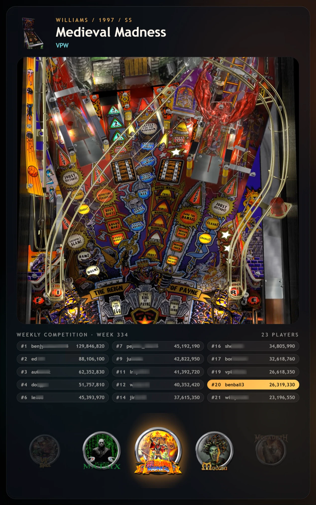

# Revolution with Scores

> **Work in progress.**  This theme is still being built and tested, and things may change or break.
>
> **Unofficial fork.**  This is an unofficial fork of the Revolution theme by superhac.  It is not made, endorsed or supported by the original author.

Revolution with VPC high scores in place of the feature tags.  It needs the Virtual Pinball Chat extension (`vpc_vpinfe`); without it every table shows "No VPC scores yet".

A theme for a desktop or a cabinet, built around a wheel.  The wheel runs down the left side.  The rest of the screen shows the table you are on: its playfield video or picture, its name, a picture of the cabinet and its high scores.

On a tall cabinet screen the wheel runs along the bottom instead.

The wheel slides one card at a time and cuts when you jump a page.  The playfield is the table's video or image, whichever Playfield Media Priority in VPinFE's settings asks for.

Under the name, the high scores panel lists the Virtual Pinball Chat scores for the table.  On the weekly competition table it shows only the weekly board.  On every other table it shows one merged board with one line per player, best score first.  Scores are shown in three columns of five.  The top three are always shown.  If your own score is lower down, the rest of the list is spread evenly between the top and your score, ending just above you, so you can see realistic targets to aim for, with your line (lit gold) and the one below it last.

## Install

Open Themes in the Console, find Revolution with Scores, and press Install.  Then press Make Active and restart VPinFE.  It needs VPinFE 3.0 or later.

## Settings

These are on the Themes page in the Console, under Revolution with Scores's settings.

| Setting | What it does |
| --- | --- |
| Start on Collection Selection | Opens the collection picker as soon as the theme starts.  When it is off, Revolution with Scores starts on the collection set by Open On in VPinFE's settings.  Off by default.  If you set this in VPinFE 2.x, your choice carries over. |
